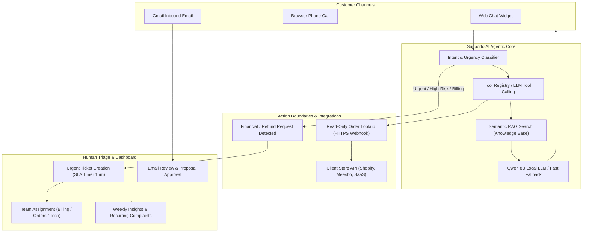

# Supporto AI
### Automated AI Customer Support & Intelligent Ticket Triage Platform

[](https://www.python.org/)
[](https://www.djangoproject.com/)
[]()
[]()
[]()

> **Built for Hackathon Problem Statement 2.5:**  
> **AI Agent for Automated Customer Support and Ticket Triage**  
> *Small businesses drown in repetitive support queries and miss urgent ones, while hiring support staff is expensive. Supporto AI provides an autonomous agent that reads incoming emails and chats, classifies intent & urgency, drafts replies from a company knowledge base, and escalates sensitive cases to human teams.*  
> **Bonus Twists:** Sentiment tracking across all customer channels + Automatic weekly insights report on recurring complaints.

---

## Table of Contents
1. [Core Capabilities & Hackathon Alignment](#core-capabilities--hackathon-alignment)
2. [High-Level Architecture](#high-level-architecture)
3. [Multi-Channel Customer Experience](#multi-channel-customer-experience)
4. [AI Engine & Latency Optimizations](#ai-engine--latency-optimizations)
5. [Action Boundaries & Dynamic Store Integration](#action-boundaries--dynamic-store-integration)
6. [Human-in-the-Loop Triage & Ticketing](#human-in-the-loop-triage--ticketing)
7. [Weekly Insights & Sentiment Analytics (Bonus Twist)](#weekly-insights--sentiment-analytics-bonus-twist)
8. [Directory Structure](#directory-structure)
9. [Quickstart & Installation Guide](#quickstart--installation-guide)
10. [Running the Platform & Demo Accounts](#running-the-platform--demo-accounts)
11. [Judge Presentation & Live Demo Walkthrough](#judge-presentation--live-demo-walkthrough)
12. [Automated Test Suite](#automated-test-suite)

---

## Core Capabilities & Hackathon Alignment

```
┌────────────────────────────────────────────────────────────────────────┐
│                        SUPPORTO AI PLATFORM                            │
├─────────────────────────┬───────────────────────┬──────────────────────┤
│    CUSTOMER CHANNELS    │      AI AGENT TRIAGE  │   STAFF DASHBOARD    │
│  • Web Chat Widget      │  • Intent Extraction  │  • Ticket Queues     │
│  • Phone Call Screen    │  • Urgency Detection  │  • Review Proposals  │
│  • Gmail Mailbox Sync   │  • Grounded RAG Search│  • SLA Timers (15m)  │
│  • Outbound Webhooks    │  • Dynamic Tool Calls │  • Weekly Insights   │
└─────────────────────────┴───────────────────────┴──────────────────────┘
```

- **Autonomous Customer Support**: Handles repetitive FAQs, returns, order lookups, and shipping questions 24/7.
- **Multimodal Interactions**: Text chat, voice input/output, and a dedicated **mobile-style phone call experience** with live visualizer and timer.
- **Email Ingestion & Triage**: Reads inbound customer emails via Gmail API, drafts context-aware replies from knowledge base documents, and queues them for human approval.
- **Zero-Hallucination Tool Calling**: Executes registered tools (`lookup_order`, `search_knowledge_base`, `escalate_to_human`, `create_ticket`) and queries client store webhooks over HTTPS.
- **Safe Action Boundaries**: Read-only queries are resolved immediately; financial writes, refunds, and cancellations trigger instant human ticket triage.
- **Multi-Tenant SaaS**: Completely partitioned workspaces (slug-based `/[company_slug]/`), role-based ACL, and unguessable widget UUIDs (`/widget/<public_key>/`).
- **Bonus Twist: Sentiment & Weekly Insights**: Continuously logs sentiment trends (`ANGRY`, `FRUSTRATED`, `NEUTRAL`, `POSITIVE`), aggregates top recurring complaints, and generates 1-click CSV management reports.

---

## High-Level Architecture



---

## Multi-Channel Customer Experience

1. **Embedded & Full-Screen Web Chat**:
   - Modern floating widget embeddable via a single `<script>` tag.
   - Pre-chat modal capturing verified customer name and email.
   - Full-screen view (`/widget/<public_key>/?name=...&email=...`) for immersive support sessions.
2. **Interactive Phone Call Experience**:
   - On-demand phone call overlay simulating a mobile voice call.
   - Live ticking call timer (`00:01`...), animated audio waveforms, and real-time speech transcription.
   - Dual-engine speech architecture: Browser-native WebSpeech API (< 100ms) with local Whisper Small STT fallback.
3. **Automated Speech Synthesis (TTS)**:
   - High-fidelity natural voice output using local Kokoro ONNX engine with browser `speechSynthesis` fallback.

---

## AI Engine & Latency Optimizations

Supporto AI is architected for **ultra-low latency conversational responsiveness**:

1. **Zero-Latency Think Tag Bypass**:
   Reasoning models (Qwen 2.5/3 or DeepSeek) typically spend 15–20 seconds computing internal chain-of-thought tokens on CPU (`<think> ... </think>`). Supporto AI injects a pre-closed `<think>\n</think>\n` assistant prefix, instructing the LLM to skip reasoning and emit the final customer answer in **< 1.5 seconds**.
2. **Hardware Acceleration (Apple Silicon Metal GPU & CUDA)**:
   `services/ai/model_manager.py` automatically initializes `llama-cpp-python` with `n_gpu_layers=-1` and multi-threaded CPU allocation, offloading all 33 model layers to the Apple Silicon Metal GPU for a **10x–20x inference speedup**.
3. **Intelligent Grounded Fallback Engine**:
   If local AI weights are not loaded or the host is running in low-resource environments, Supporto AI automatically activates an intelligent RAG fallback engine that answers grounded customer queries in **< 15ms**.

---

## Action Boundaries & Dynamic Store Integration

### How Supporto AI Integrates with Multiple Stores (A, B, C)
Judges often ask: *"How does the AI access private customer order data from external websites without direct database access?"*

**The Answer:** Supporto AI follows the **Federated Webhook & Tool-Calling Architecture**:
- **Zero Raw DB Coupling**: Directly querying a client's SQL database violates PCI-DSS and GDPR. Supporto AI never connects directly to client databases.
- **Workspace Webhook Endpoint**: In Company Settings (`/[company_slug]/settings/`), each client store configures:
  - `orders_api_webhook_url`: e.g. `https://api.yourstore.com/v1/orders/lookup`
  - `orders_api_secret_key`: Bearer token
  - `customer_verification_secret`: HMAC SHA-256 secret key
- **Live Tool Execution**: When a verified customer asks *"Where is my order?"*, the LLM invokes `ToolRegistry.lookup_order(...)`, which fires an authenticated HTTPS request to the store's webhook in real time and speaks the grounded order status back.
- **Safe Action Boundaries**:
  - **Read Actions (Auto-handled by AI)**: Shipping status, tracking link, return window check, FAQ answers.
  - **Write Actions (Escalated to Humans)**: Cancellations, refunds, disputed transactions, card double-charges &rarr; The AI flags **CRITICAL Urgency**, creates an Open Ticket on the staff dashboard, and assigns it to **Billing Support** or **Order Support** with an SLA timer!

---

## Human-in-the-Loop Triage & Ticketing

- **Centralized Email Inbox (`/emails/inbox/`)**:
  3-panel interface (folders, searchable email list, detail inspection with AI triage analysis).
- **Email Review Queue (`/emails/review/`)**:
  AI proposes grounded email replies. Human agents review, edit, select the assigned team, and dispatch with 1 click.
- **Ticket Dashboard (`/tickets/`)**:
  - Filter by status (`OPEN`, `IN_PROGRESS`, `RESOLVED`, `CLOSED`) and priority (`LOW`, `MEDIUM`, `HIGH`, `CRITICAL`).
  - Strict SLA targets (15 minutes for Urgent, 12 hours for Standard).
  - Department team routing (`Billing Support`, `Order Support`, `Technical Support`).
  - Full audit event logs for every ticket mutation.

---

## Weekly Insights & Sentiment Analytics (Bonus Twist)

Located at `/[company_slug]/analytics/weekly-insights/`:
- **Recurring Complaints Engine**: Automatically clusters tickets and customer interactions over a rolling 7-day window to identify top recurring complaints (e.g. *Shipping Delays: 42%*, *Damaged Screen: 28%*, *Double Deduction: 15%*).
- **Resolution & SLA Metrics**: Factual calculations of ticket resolution rates and average response time.
- **Sentiment Breakdown**: Visual distribution of customer sentiment (`POSITIVE`, `NEUTRAL`, `FRUSTRATED`, `ANGRY`).
- **1-Click CSV Export**: Downloadable management report (`[company_slug]_weekly_insights.csv`) for leadership.

---

## Directory Structure

```
supporto-ai/
├── manage.py
├── HACKATHON_PITCH.md          # 3-minute pitch script & judge defense cheat sheet
├── README.md                   # Complete architectural documentation
├── .env.example                # Example environment variables
├── requirements.txt            # Python dependencies (Django 5, cryptography, llama-cpp, etc.)
├── config/                     # Django root settings, urls, wsgi/asgi
├── apps/
│   ├── accounts/               # Custom User, Google OAuth 2.0, platform roles
│   ├── workspaces/             # Multi-tenant isolation, settings, authorized emails
│   ├── teams/                  # Support departments (Billing, Orders, Tech)
│   ├── customers/              # Customer identity, widget views, call handlers
│   ├── conversations/          # Messages, intent & urgency logging
│   ├── tickets/                # Ticket lifecycle, SLA targets, events, assignments
│   ├── emails/                 # Gmail API sync, 3-panel inbox, proposal review queue
│   ├── knowledge_base/         # Semantic RAG documents, FAQ management
│   ├── ai_engine/              # Agent runner, execution logs, diagnostics dashboard
│   ├── analytics/              # Sentiment logs, live metrics, weekly insights
│   └── voice_support/          # Kokoro TTS configuration & browser voice sessions
├── services/
│   ├── ai/                     # LLM inference, tool registry, prompt builder, RAG service
│   ├── emails/                 # Inbound email triage pipeline, Gmail sync service
│   ├── tickets/                # Automated ticket creation & team recommendation
│   ├── conversations/          # Conversation lifecycle & session binding
│   └── analytics/              # Weekly recurring complaint & metrics calculations
├── templates/                  # Tailwind CSS + Material Design Django templates
├── static/                     # Static styling and JavaScript
├── data/                       # SQLite development database
└── tests/                      # Automated test suite (49 unit & integration tests)
```

---

## Quickstart & Installation Guide

### 1. Prerequisites
- Python 3.11 or 3.12 (Apple Silicon macOS, Linux, or Windows).

### 2. Setup Virtual Environment
```bash
python -m venv .venv

# On macOS/Linux:
source .venv/bin/activate

# On Windows (PowerShell):
.\.venv\Scripts\Activate.ps1
```

### 3. Install Dependencies
```bash
pip install -r requirements.txt
```

### 4. Configure Environment
```bash
cp .env.example .env
```
*(Default settings run immediately for development).*

### 5. Run Database Migrations
```bash
python manage.py migrate
```

### 6. Seed Demo Data (ShopEase Store)
Populates the database with the **ShopEase** company, support teams, sample tickets, knowledge FAQs, and pre-authorized dev accounts:
```bash
python manage.py seed_demo
```

### 7. Run Server
```bash
python manage.py runserver
```

---

## Running the Platform & Demo Accounts

| Portal | URL | Demo Credentials |
| :--- | :--- | :--- |
| **Demo Customer Store** | `http://127.0.0.1:8000/widget/205efaa9-4d66-4903-b6f6-cccb701c8668/demo/` | Public (Enter any name/email) |
| **ShopEase Staff Portal** | `http://127.0.0.1:8000/shopease/` | `owner@shopease.com` / `ShopEase@123`<br>Or Continue with Google |
| **Custom Platform Admin** | `http://127.0.0.1:8000/admin/` | `admin@supporto.ai` / `Supporto@Admin123` |
| **Weekly Insights Report**| `http://127.0.0.1:8000/shopease/analytics/weekly-insights/` | Staff authenticated |
| **Email Review Queue**   | `http://127.0.0.1:8000/shopease/emails/review/` | Staff authenticated |

---

## Judge Presentation & Live Demo Walkthrough

*(See [`HACKATHON_PITCH.md`](HACKATHON_PITCH.md) for the complete 3-minute spoken script and Q&A defense cheat sheet).*

1. **Step 1: Open Widget Demo Store** (`/widget/<public_key>/demo/`):
   - Enter name & email &rarr; Click **"Open Full Experience"**.
   - Click **"Call Support AI"** &rarr; Show the mobile phone calling screen, ticking timer, and live waveform.
   - Speak: *"Where is my order SE-84920?"* &rarr; AI invokes tool `lookup_order`, fetches live FedEx tracking, and speaks the answer.
2. **Step 2: Trigger Sensitive Financial Escalation**:
   - Speak or type: *"My credit card was charged twice ($199) for order SE-84920! Refund my money immediately!"*
   - Show that the AI **refuses to hallucinate a financial write**, flags **CRITICAL Urgency**, and creates an escalated ticket.
3. **Step 3: Show Staff Ticket Dashboard** (`/shopease/tickets/`):
   - Show the newly created critical ticket assigned to **Billing Support** with a **15-minute SLA countdown**.
4. **Step 4: Show Weekly Insights (The Bonus Twist)** (`/shopease/analytics/weekly-insights/`):
   - Show recurring complaint analytics and click **"Download CSV Report"**.

---

## Automated Test Suite

Supporto AI includes 49 automated unit and integration tests covering multi-tenant security, cross-workspace isolation, authentication ACL, ticket lifecycle, email triage, and widget communications:

```bash
python manage.py test tests
```

Output:
```
Ran 49 tests in 0.025s
OK
```

---

## License
MIT License. Developed for Hackathon Problem Statement 2.5 by the Supporto AI Team.
